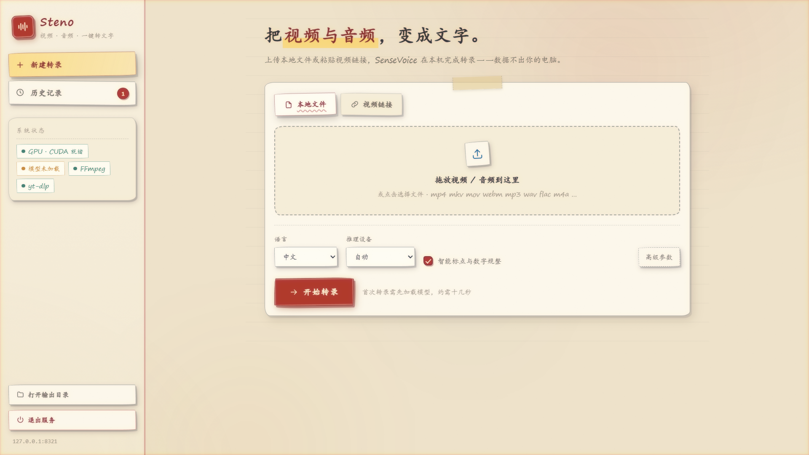

# steno · 视频/音频速记工具

基于 [SenseVoiceSmall](https://github.com/FunAudioLLM/SenseVoice) 模型的速记工具，支持视频提取音频并转录为文字。



## 环境要求

- Python 3.8+
- FFmpeg（需添加到系统 PATH）
- yt-dlp（URL 下载用，`pip install yt-dlp`）
- CUDA GPU（推荐 4GB+ 显存）

## 安装依赖

```bash
pip install torch soundfile yt-dlp
```

## 使用方法

### 网页界面（推荐）

```bash
python webui.py            # 启动后自动打开浏览器，默认 http://127.0.0.1:8321
python webui.py --port 9000 --no-browser
python webui.py --no-preload   # 不在后台预加载模型（默认后台预加载）
```

- 拖放 / 选择本地媒体文件，或粘贴视频链接（YouTube、B站等，支持仅下载音轨与浏览器 cookies）
- 实时展示 下载 → 加载模型 → 提取音频 → 转录 各阶段进度，可中途取消
- 转录结果在线查看、复制、下载；历史记录浏览、搜索、删除
- 侧栏展示 GPU / 模型 / FFmpeg / yt-dlp 状态；退出服务按钮可一键关闭后台

### 容错与重试

- **转录失败自动降级**：显存不足会直接回落 CPU；其他失败会依次尝试「同参数重试 → 关闭 ITN → 分块减半 → 回落 CPU」，每次降级都在界面上说明原因
- **重试按钮**：失败/取消的任务显示「重试」，已完成的任务显示「重新转录」
- **不重复下载**：重新转录直接复用 `videos/` 里已下载/已上传的媒体文件，跳过下载阶段；同一 URL 重复提交时，若文件已存在也直接跳过下载
- 历史记录卡片上的「重新转录」同样复用已有媒体

### 命令行

```bash
# 基本用法（本地文件）
python transcribe_video.py <输入文件路径>

# 直接传视频网站 URL，自动下载后转录（支持 YouTube、B站等数千个站点）
python transcribe_video.py <视频URL>

# URL 仅下载音轨（转录只需音频，下载更快、占盘更小）
python transcribe_video.py <视频URL> --audio-only

# 需登录的站点（会员内容等）从浏览器读取 cookies
python transcribe_video.py <视频URL> --cookies-from-browser chrome

# 指定输出文件
python transcribe_video.py <输入文件路径或URL> -o <输出文件路径>
```

URL 下载的视频保存在 `videos/` 目录（文件名格式 `标题 [视频ID].mp4`），重复运行同一 URL 不会重复下载，转录结果保存为同名 `_out.txt`。

## 支持的格式

**视频：** mp4, avi, mkv, mov, wmv, flv, webm, m4v

**音频：** wav, mp3, flac, ogg, aac, m4a, wma

## 使用示例

```bash
python transcribe_video.py "videos/meeting.mp4"
python transcribe_video.py "audio.wav" -o "result.txt"
```

## 输出

- 转录结果保存为 `<原文件名>_out.txt`
- 自动过滤模型输出的表情符号（🎼 等）

## 技术说明

- **启动速度：** torch / funasr / soundfile 等重型依赖均为惰性导入（用到的函数内部再 import），`python transcribe_video.py --help` 与 WebUI 启动均在 1 秒内完成；模型与 torch 的加载放到后台线程，不阻塞界面
- **URL 下载：** 基于 [yt-dlp](https://github.com/yt-dlp/yt-dlp) 的 Python API，默认选最优画质并与音轨合并为 mp4；`--audio-only` 仅拉取音轨
- **分块策略：** 120 秒/块，1 秒重叠。SenseVoiceSmall 的 CTC decoder 在约 120 秒内表现最佳——更短会产生切块边界噪音（语句断裂、重复），更长则对齐质量下降
- **显存占用：** 模型 234M 参数（FP32 ~934MB），120s 分块推理约占用 1.5GB，4GB 显存可正常运行
- **输出清洗：** 自动过滤模型输出的情绪/事件 emoji（🎼😡👏等，按 Unicode 表情区段整体过滤）
- **冒烟测试：** `python smoke_test.py` 验证降级链、重试接口、媒体复用与任务数上限（不需要 pytest）
